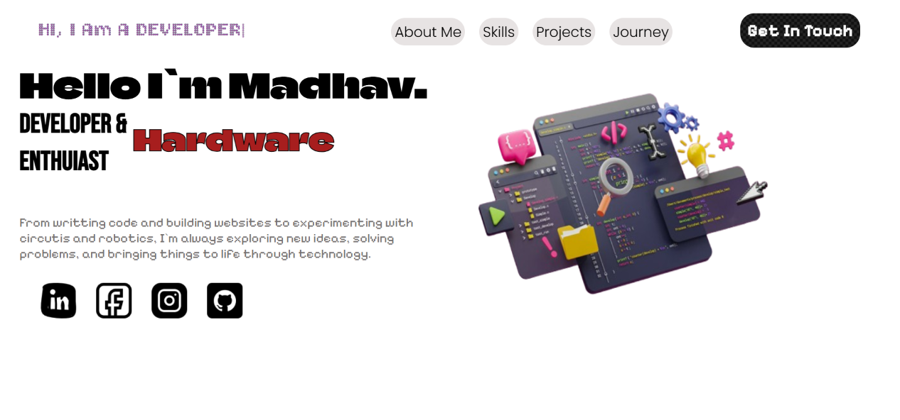
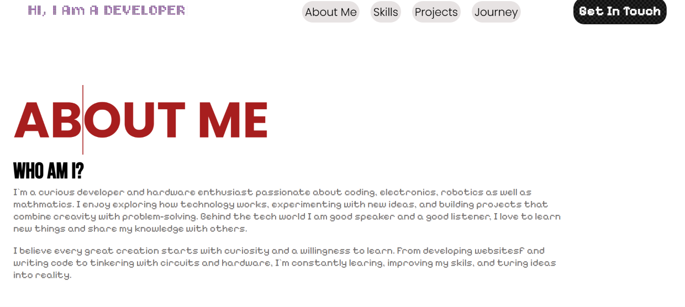

# PORTFOLIO
A simple portfolio that include hero section, interactive nav bar, about me section, skills , journey and working contact me section.
## Website Overview
### Home Page

### About Page

## Theme and Design
The website follows minimalist , modern , and creative design with bold elements.

## Website Sections
- Home: Introduction featuring my name, developer identify, interest , creative illustration, and social media links.
- About Me: About my passion for programming, electronics and mathematics.
- Skills: Showcasing some technical abilities.
- Projects: Collection of my personal projects and creations.
- Journey: Timeline highlighting my learning experience and achievements.
- contact: A section where visitors can contact me.
  
## Key Features
* Interactive Navbar
* Attractive hero section
* links sections
* about me section
* hovering effects and animation
* typing effects and fully functional form

### Propose
This project is just create to practice html , css and js .Simply to challenge my coding skills also to know how can i apply my coding and learning skills to make cools features.

## Getting Started
### Dependencies
No external libraries or frameworks are required
- A modern web browser (Edge)
- A code editor such as Visual Studio Code (recommended).
- A operating system (Window 11 pro )
- HTML5, CSS3, JavaScript support.
### Installing
- Clone this repository or download the zip file
git clone https://github.com/prateekadk26-prog/portfolio
- Navigate to the project folder.
cd portfolio
- Open the project folder in VS code
code .
- Make sure all project files and folders are in their correct locations.

### Executing Program
- Open the project folder in VS code.
- Locate index.html.
- Right click on index.html.
- Select Open with Live Server (if the Live Server extension is installed).
Alternatively, simply double-click index.html to open the website in your browser.
## License
This project is licensed under MIT License - see the [LICENSE](LICENSE)

## Project Structure
Portfolio/
- index.html
- style.css
- script.js
- images/

## Author
Pratik Adhikari

## Demo link
https://madhav-prot.netlify.app/

